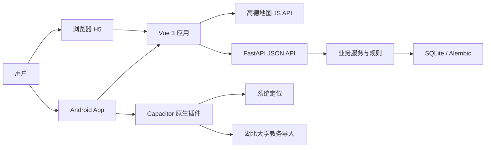

# 架构概览

智行采用共享 Vue 前端、Android 原生能力桥接和 FastAPI 后端的分层结构。

## 前端

- `src/api`：认证、课程、地点、留言、学期和出发建议请求。
- `src/stores`：登录、课程、地点和学期状态。
- `src/pages`：首页、地点频道、课程表、教务导入、出发建议和个人中心。
- `src/utils`：定位、周次、地图、课程解析、导航和存储策略。
- `android`：Capacitor 容器、原生定位权限和教务 WebView 导入插件。

网页端与 Android 复用同一套 Vue 页面。设备能力通过 Capacitor 检测后使用原生实现，浏览器保留标准 Web API 兜底。

## 后端

- `app/api`：HTTP 路由与鉴权边界。
- `app/services`：课程导入、周次、定位距离、留言和出发建议规则。
- `app/models`、`app/schemas`：数据库模型与请求响应模型。
- `migrations`：Alembic 数据库演进。
- `tests`：API、规则、安全、迁移和时区测试。

## 关键边界

- 前后端通过 JSON API 通信，Android 不直连数据库。
- 定位只用于用户主动触发的定位、出发建议和地点频道距离校验。
- 教务导入整批覆盖当前课表；解析失败的单条课程不会破坏其余导入结果。
- 地图安全密钥在生产环境通过服务代理配置。
- 账号体系目前为项目账号 + 短期 JWT 访问令牌 + 可撤销轮换刷新会话，尚未接入学校统一身份认证。
