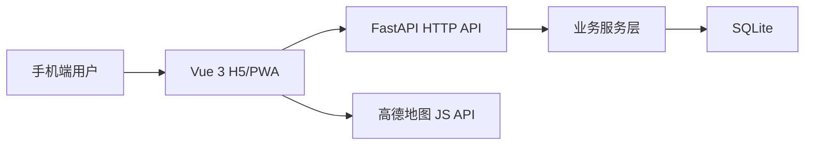

# 技术亮点

本文档用于说明智行 CampusMind 当前版本中更适合面试讲解的工程细节。

## 总体架构



- 前端负责移动端交互、地图展示、课程表、聊天室和出发建议页面。
- 后端负责认证、数据持久化、权限隔离、课表导入解析、课程/留言/建议规则。
- 地图能力由高德 JS API 提供，项目内保留配置检查、加载失败和路线失败兜底。

## 后端模块

| 模块 | 入口 | 说明 |
| --- | --- | --- |
| 认证 | `backend/app/api/auth.py` | 注册、登录、当前用户、资料编辑、JWT 鉴权 |
| 建筑 | `backend/app/api/buildings.py` | 建筑列表、建筑详情、位置数据 |
| 留言 | `backend/app/api/messages.py` | 建筑总频道、教室频道、匿名留言、定位距离校验 |
| 课程 | `backend/app/api/courses.py` | 课程 CRUD、HTML/Excel 导入预览 |
| 建议 | `backend/app/api/schedule.py` | 下一节课识别、出发建议、距离和状态计算 |

## 前端模块

| 模块 | 入口 | 说明 |
| --- | --- | --- |
| 地图首页 | `frontend/src/pages/HomePage.vue` | 校园地图、地点搜索、地图点位分层 |
| 地图组件 | `frontend/src/components/RealCampusMap.vue` | 高德地图加载、点位、路线预览 |
| 聊天室 | `frontend/src/pages/BuildingChatroomsPage.vue` | 建筑总频道和教室频道选择 |
| 留言页 | `frontend/src/pages/BuildingMessagesPage.vue` | 气泡聊天、定位状态、禁用输入 |
| 课程表 | `frontend/src/pages/CoursesPage.vue` | 周次筛选、整周课表网格、课程操作 |
| 课表导入 | `frontend/src/pages/CourseImportPage.vue` | HTML/Excel 上传预览和导入 |
| 出发建议 | `frontend/src/pages/SchedulePage.vue` | 起终点搜索、建议生成、地图路线 |

## 数据设计

核心表包括：

- `users`：账号、昵称、头像、角色和密码哈希。
- `buildings`：校园地点、建筑类型、经纬度、地图坐标和提示信息。
- `messages`：建筑/教室频道留言，保存真实用户 id，前端统一匿名展示。
- `courses`：课程名、星期、节次/时间、周次、教师、教室和所属用户。
- `location_presets`：早期演示位置数据，当前主要由建筑点位和搜索承担位置选择。

## 认证与权限

- 密码使用哈希存储，不返回密码哈希。
- JWT 用于前端登录态和后端接口保护。
- 课程接口只允许操作当前登录用户自己的课程。
- 留言接口需要登录；发布留言时校验用户定位与目标建筑距离。

## 建筑会话设计

建筑会话被拆成两层：

1. 建筑总频道：适合讨论建筑整体信息，例如教学楼开放、拥堵、失物招领。
2. 教室频道：从建筑进入后可选择具体教室，例如教4-203，适合更具体的课堂或自习信息。

这样既保留了项目最初的“建筑留言”特色，又能支撑更真实的校园交流场景。

## 课程表与导入

课程表支持两种录入方式：

- 手动新增/编辑课程。
- 导入 HTML 或 Excel 课表后预览，再批量写入。

导入逻辑会解析课程名、教师、周次、节次、教室等信息，并尝试把教室文本自动匹配到已有校园建筑，减少用户手动选择建筑的步骤。

## 周次筛选

课程保存时保留 `weeks` 文本，例如 `1-16`、`2,4,6,8`、`1-16(单)`。前端工具函数负责判断课程是否属于当前选择周次，并在课表网格中展示当周课程。

## 出发建议规则

出发建议不是简单固定文案，而是组合了以下规则：

- 从当前用户课程中识别未来最近一节课。
- 如果用户没有手动选择终点，则默认使用下一节课地点。
- 起点可以来自搜索地点、建筑点位或浏览器定位。
- 后端返回下一节课、起点、终点、距离、步行时间、缓冲时间和建议出发状态。
- 前端优先展示高德地图路线预览，失败时给出清晰提示，避免页面一直刷新干扰用户。

## 地图工程处理

- 通过 `.env.local` 配置高德 Web 端 JS API Key 和安全密钥。
- 地图点位支持搜索和缩放分层，避免一屏点位过密。
- 对校园点位保留手动采点能力，便于后续补充高德搜索不到的校内细地点。
- 路线规划失败不会阻断出发建议主流程。

## 测试覆盖

当前测试覆盖：

- 后端健康检查、认证、建筑、留言、课程、课表导入、出发建议。
- 前端认证状态、路由守卫、API 封装、地图/搜索工具、课程工具、定位 store、出发建议工具和登录动效工具。

最近一次整理验证：

```text
backend: 61 passed
frontend: 81 passed
npm run build: passed
```

## 可继续扩展

- 接入湖北大学统一身份认证。
- 引入 WebSocket 做实时聊天室。
- 增加管理员审核、举报和隐藏消息能力。
- 将 SQLite 迁移到 PostgreSQL/MySQL。
- 对接更完整的校园路径数据和推送提醒。
