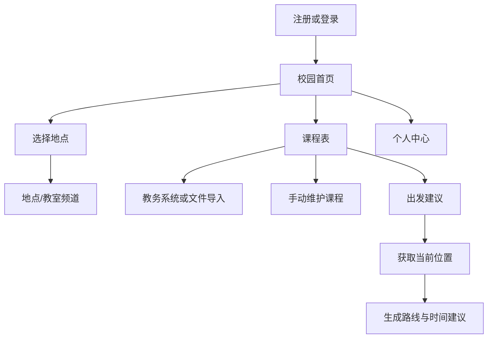

# 用户主流程

## 课程导入

1. 用户进入课程表并设置学期。
2. Android 用户可打开教务系统，网页用户可选择 HTML/Excel 文件。
3. 系统解析课程、教师、地点、节次和周次。
4. Android 教务课表解析后自动覆盖导入；HTML/Excel 文件展示预览后由用户提交。
5. 时间和地点同时缺失，或课程名、星期、周次等关键排课字段无法识别的条目自动排除；仅缺时间或仅缺地点不会阻断其余课程。
6. 本次可用结果覆盖原课表；地点暂未匹配地图时仍可查看课表，发起路线时再补全。

## 定位与地点频道

1. 用户进入某个地点或教室频道。
2. 页面等待用户主动点击定位。
3. Android 调用系统定位，网页调用浏览器定位。
4. 距离目标地点在允许范围内时开放发布；否则保持只读。
5. 后端再次校验坐标，避免绕过前端。

## 出发建议

1. 起点可使用当前定位、校园地点或手动搜索。
2. 终点可使用下一节课地点或手动选择。
3. 后端计算课程状态、时间和缓冲建议。
4. 前端展示步行路线；地图失败时仍保留文字建议。
